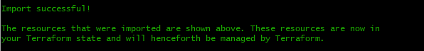

# Lab overview

In this lab, you will learn how to import resources to let Terraform manage their lifecycle.

We will create a NSG and add a rule manually, from AZ CLI commands, and we will import these resources to Terraform.

- [Lab overview](#lab-overview)
  - [Objectives](#objectives)
  - [Instructions](#instructions)
    - [Before you start](#before-you-start)
    - [Exercise 1: Setup your environment (*tfstate* and project template)](#exercise-1-setup-your-environment-tfstate-and-project-template)
      - [Backend](#backend)
      - [Variables](#variables)
    - [Exercise 2: Deploy a Network Security Group using AZ CLI](#exercise-2-deploy-a-network-security-group-using-az-cli)
    - [Exercise 3: Import the Network Security Group in tfstate](#exercise-3-import-the-network-security-group-in-tfstate)
      - [Init backend](#init-backend)
      - [Prepare Terraform template](#prepare-terraform-template)
      - [Import resource](#import-resource)
      - [Check imported data](#check-imported-data)
    - [Exercise 4: Import the Network Security Group Rule in tfstate](#exercise-4-import-the-network-security-group-rule-in-tfstate)
    - [Exercise 5: Destroy the infrastructure](#exercise-5-destroy-the-infrastructure)

## Objectives

After you complete this lab, you will be able to:

- Import a Network Security Group, and Network Security Rules,
- Understand how Terraform handles existing infrastructure using import.

## Instructions

### Before you start

- Ensure Terraform (version ~> 1.13) is installed and available from system's PATH.
- Ensure Azure CLI is installed.
- Check your access to the Azure Subscriptions and Resource Groups provided for this training.

### Exercise 1: Setup your environment (*tfstate* and project template)

1/ Create the container for *tfstate*

In your *main* Resource Group (the one tagged with `layer` = `main`), create a Storage Account, with a Blob container named `tfstate` to store the *tfstate* file.

2/ Get project template

Clone the repository https://github.com/Anne-Gaelle-Cellenza/training-terraform-intermediate-labs-setup

```bash
git clone https://github.com/Anne-Gaelle-Cellenza/training-terraform-intermediate-labs-setup.git
cd training-terraform-intermediate-labs-setup
```

> This template contains a basic Terraform project configuration that:
>
> - uses a `data` resource group,
> - defines two variables `resource_group_name` and `location`,
> - contains a `configuration\dev` folder with *backend* and *tfvars* for dev.

3/ Configure the project template to use your environment

#### Backend

The project template uses a partial backend configuration: we don't define the backend configuration in the `terraform` block but in an external file, read at `terraform init` time.

In the *configuration/dev* folder, update the `backend.hcl` file as:

```hcl
  resource_group_name  = "the_name_of_your_main_resource_group"
  storage_account_name = "the_name_of_the_storage_account_you_just_created"
  container_name      = "tfstate"
  key                 = "import.tfstate"
```

> Define your backend using the Storage Account you created few minutes ago.

#### Variables

In the *configuration/dev* folder, update the `dev.tfvars` file:

```hcl
resource_group_name = "the_name_of_your_main_resource_group"
```

### Exercise 2: Deploy a Network Security Group using AZ CLI

At first, create a Network Security Group using Azure CLI commands.

> This NSG will be our existing infrastructure **not deployed using Terraform**.

PowerShell

```powershell
az login
az account set --subscription "id_of_the_training_subscription"
$resourceGroupName = "your_resource_group_name"
```

Bash

```bash
az login
az account set --subscription "id_of_the_training_subscription"
resourceGroupName="your_resource_group_name"
```

Create the NSG with az cli and add a rule to that NSG:

PowerShell

```powershell
# creates the NSG in RG $resourceGroupName
az network nsg create --name "importdemo-nsg" --resource-group $resourceGroupName --location "westeurope"

# Create a rule over TCP for a specific IP adress range
az network nsg rule create -g $resourceGroupName `
                           --nsg-name "importdemo-nsg" `
                           -n "SampleRule" `
                           --priority 100 `
                           --direction Outbound `
                           --source-address-prefixes '*' `
                           --source-port-ranges '*' `
                           --destination-address-prefixes '*' `
                           --destination-port-ranges '*' `
                           --access Allow `
                           --protocol Tcp
```

Bash

```bash
# creates the NSG in RG $resourceGroupName
az network nsg create --name "importdemo-nsg" --resource-group $resourceGroupName --location "westeurope"

# Create a rule over TCP for a specific IP adress range
az network nsg rule create -g $resourceGroupName \
                           --nsg-name "importdemo-nsg" \
                           -n "SampleRule" \
                           --priority 100 \
                           --direction Outbound \
                           --source-address-prefixes '*' \
                           --source-port-ranges '*' \
                           --destination-address-prefixes '*' \
                           --destination-port-ranges '*' \
                           --access Allow \
                           --protocol Tcp
```

> Check the create NSG + associated rule from Azure portal.

### Exercise 3: Import the Network Security Group in tfstate

We now have a resource in Azure which is not managed by our Terraform templates.Purpose is now to *import* this resource to Terraform.Steps are:

- init backend
- prepare the Terraform template (add a resource block that will shelter the imported resource, add variables if needed, ...)
- import the resource using az cli
- generate the terraofrm plan and verify all is ok.

#### Init backend

PowerShell

```powershell
az login
az account set --subscription "the_main_subscription_id"
$env:ARM_SUBSCRIPTION_ID="the_main_subscription_id"
# use the '-reconfigure' option in case your local folder was previously configured with a different backend (e.g. from previous labs)
terraform init -backend-config="..\configuration\dev\backend.hcl" -reconfigure
```

Bash

```bash
az login
az account set --subscription "the_main_subscription_id"
export ARM_SUBSCRIPTION_ID="the_main_subscription_id"
# use the '-reconfigure' option in case your local folder was previously configured with a different backend (e.g. from previous labs)
terraform init -backend-config="..\configuration\dev\backend.hcl" -reconfigure
```

#### Prepare Terraform template

Add a new variable for the Network Security Group name if the `variables.tf` file and give a value in `dev.tfvars`:

`variables.tf`

```hcl
variable "network_security_group_name" {
  type = string
  description = "Network Security Group Name"
}
```

`dev.tfvars`

```hcl
network_security_group_name = "importdemo-nsg"
```

Update the template in the `main.tf` file adding the resource block for the Network Security Group:

```hcl
resource "azurerm_network_security_group" "nsg" {
  name                = var.network_security_group_name
  location            = var.location
  resource_group_name = data.azurerm_resource_group.self.name
}
```

> Our template is now ready for importing the resource in the tfstate file.

#### Import resource

To get the Network Security Group Resource Id from the Azure Portal, you can navigate to the deployed Network Security Group in your subscription, and copy the Resource ID available in *Settings -> Properties* pane.

You can now run the following command to import the resource:

PowerShell

```powershell
$nsgResourceId = "the_resource_id_you_just_copied"
terraform import -var-file="..\configuration\dev\dev.tfvars" azurerm_network_security_group.nsg $nsgResourceId
```

Bash

```bash
# required for Git Bash on Windows to avoid path conversions
export MSYS_NO_PATHCONV=1
nsgResourceId="the_resource_id_you_just_copied"
terraform import -var-file="..\configuration\dev\dev.tfvars" azurerm_network_security_group.nsg $nsgResourceId
```

> Note the successful import message.
> 
>
> The resource is now imported in tfstate.
>
> - we have operated the match between tfstate and Azure resource
> - we must now verify the match between tfsate and Terraform template

Now that the resource is now managed by Terraform, it can be updated or deleted during Terraform apply or destroy command.

#### Check imported data

Generate a plan using the following command:

```powershell
terraform plan -var-file="..\configuration\dev\dev.tfvars"
```

> No change reported by terraform plan, all is good.  
>
> The rule that we manually added to the NSG is not considered by Terraform as part of the NSG itself, as a dedicated resource template exists for such object.
> This explains why the rule doesn't appear as a drift between Terraform NSG template and the Azure resource.
> For the rule to also be managed by Terraform, we must import it the same way as for the NSG.

### Exercise 4: Import the Network Security Group Rule in tfstate

The Network Security Group Rule is a distinct resource in Terraform that must be imported by its own.

Add a new resource blcok in `main.tf` as

```hcl
resource "azurerm_network_security_rule" "example" {
  name                        = "SampleRule"
  priority                    = 100
  direction                   = "Outbound"
  access                      = "Allow"
  protocol                    = "Tcp"
  source_port_range           = "*"
  destination_port_range      = "*"
  source_address_prefix       = "*"
  destination_address_prefix  = "*"
  resource_group_name         = data.azurerm_resource_group.self.name
  network_security_group_name = azurerm_network_security_group.nsg.name
}
```

We now need the Azure Resource ID for the rule before being able to run the az cli import command.
Note that it's not possible to get the Resource ID for a Network Security Group Rule from the Azure portal. We can either get an example of the command line from Terraform [documentation](https://registry.terraform.io/providers/hashicorp/azurerm/latest/docs/resources/network_security_rule#import) or use Az CLI as done below.

```powershell
az network nsg rule show -g $resourceGroupName --nsg-name "importdemo-nsg" -n "SampleRule"
```

In the json output, get and copy the "id" attribute value.  
We can now run the import command:

PowerShell

```powershell
$ruleResourceId = "the_resource_id_you_just_got_from_az_cli"
terraform import -var-file="..\configuration\dev\dev.tfvars" azurerm_network_security_rule.example $ruleResourceId
```

Bash

```bash
export MSYS_NO_PATHCONV=1
ruleResourceId="the_resource_id_you_just_got_from_az_cli"
terraform import -var-file="..\configuration\dev\dev.tfvars" azurerm_network_security_rule.example $ruleResourceId
```

> Note the successful import message.
>
> The resource is now imported in tfstate, so the mirroring Azure/tfstate is done. We now need to proceed further with the mirroring Terraform template/tfstate. This is done thanks to a terraform plan.

```powershell
terraform plan -var-file="..\configuration\dev\dev.tfvars"
```

> No change is reported.  
> Th Terraform template we added in `main.tf`  is complete enough!
>
> Note that, in some cases, we might need to uUpdate the Terraform template based on plan output...

Now that the resource is now managed by Terraform, it can be updated or deleted during Terraform apply or destroy command.

### Exercise 5: Destroy the infrastructure

The Network Security Group and the rule are now managed by Terraform.
We can remove them using a destroy command

```powershell
terraform destroy -var-file="..\configuration\dev\dev.tfvars" -auto-approve
```

> Check in the Azure portal that the resources have been removed.
